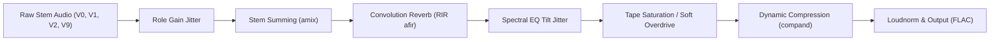

# Spec 17: Vocal Leads, Studio Production FX, Sub-Measure Inversion Slicing, and 10k Target Corpus

**Status:** Proposed  
**Depends on:** [Spec 15 - Sound Design and ACR Corpus Production](15-sound-design-and-acr-corpus.md), [Spec 16 - Synthetic Generator Fidelity and Melodic Improvements](16-generator-fidelity-and-melodic-improvements.md)  
**Audience:** Symbolic generator, bass module, melody engine, audio rendering pipeline, label conversion, and ACR evaluation

---

## 1. Overview and Problem Statement

Following the implementation of Spec 16 and subsequent benchmark training on ChordFormer, empirical evaluation revealed three specific opportunities to improve acoustic fidelity and label accuracy:

1. **Bass Labeling vs. Acoustic Mismatch**:
   - `bass_module.py` introduced naturalistic walking bass lines, scalar passing lines, and root-5th alternations across measures.
   - However, exported Harte `.lab` annotations were emitted strictly at the whole-measure chord progression level (e.g. `0.000 4.000 C:maj`). In Harte syntax, omitting a slash note forces the bass label to equal the root note for the entire duration.
   - On beats 2, 3, and 4 of walking measures, the audio physically produces the 3rd ($E$), 5th ($G$), or approach note as the lowest sounding pitch, yet the loss function penalizes the model for predicting non-root bass. This caused synthetic validation frame accuracy for the bass head to fall to 74.0%.
   - **Resolution**: Sub-measure inversion slicing. Whenever the bass track plays non-root chord tones or passing inversions, the event timeline must emit time-sliced Harte chord slices (e.g. `0.000 2.000 C:maj`, `2.000 4.000 C:maj/5`), teaching the neural network genuine acoustic inversion tracking.

2. **Absence of Human Vocal Formant Interference**:
   - Real-world commercial pop and rock songs feature lead and backing vocalists whose vocal formants ($F_1, F_2, F_3$), vowel modulations, and vibrato strongly interfere with the underlying harmony.
   - `MELODY_INSTRUMENTS` currently only selects woodwinds, strings, brass, and clean guitars.
   - **Resolution**: Incorporate General MIDI vocal programs (GM 52 *Choir Aahs*, GM 53 *Voice Oohs*, GM 54 *Synth Voice*) into the melody catalog, utilizing multi-sampled vocal banks across the SoundFont ensemble.

3. **Clinical MIDI Audio vs. Commercial Studio Production**:
   - Real audio recordings contain dynamic bus compression, analog tape saturation, and diverse microphone/console EQ curves.
   - **Resolution**: Expand the FFmpeg filter chain in `audio_render.py` with randomized dynamic glue (`compand`), soft tape overdrive/saturation, and subtle spectral EQ tilt jitter.

4. **Corpus Scale & Long-Tail Representation**:
   - Scale the synthetic training dataset from 5,000 songs to **10,000 songs** (~1,000,000 chord events, ~600 hours of audio).
   - Slightly elevate the jazz/complex split (from 70/30 to 65/35) and tune rare-triad and altered-extension quotas to maximize long-tail transfer without skewing major/minor priors.

---

## 2. Module 1: Sub-Measure Inversion Slicing (`bass_module.py` & Label Export)

### 2.1 The Inversion Slicing Mechanism
When a chord event has a duration of a whole note (`w`) or dotted half (`h.`) and the bass module generates a walking or alternating pattern:
1. **Root-Fifth Alternation (`h + h`)**:
   - The audio plays Root for 2 beats, then 5th for 2 beats.
   - The chord event in `data["chords"]` and `.lab` is split into two equal temporal slices:
     - Slice 1 ($[t_0, t_0 + \Delta/2]$): Base chord (e.g. `C:maj`).
     - Slice 2 ($[t_0 + \Delta/2, t_1]$): Explicit 5th inversion (e.g. `C:maj/5`).
2. **Scalar Walking Line (`q + q + q + q`)**:
   - Beat 1: Root $\rightarrow$ `C:maj`
   - Beat 2: 3rd $\rightarrow$ `C:maj/3` (or `C:maj/b3` for minor)
   - Beat 3: 5th $\rightarrow$ `C:maj/5`
   - Beat 4: Chromatic approach note $\rightarrow$ `C:maj/7` or approach note pitch class (e.g. `C:maj/B`).
3. **Beat 4 Chromatic Approach (`h. + q`)**:
   - Beats 1–3 ($3/4$ of duration): Base chord (`C:maj`).
   - Beat 4 ($1/4$ of duration): Approach inversion (e.g. `C:maj/7`).

### 2.2 Genre-Aware Bass Anchoring
- **Pop/Rock (65% of corpus)**:
  - 60% of measures: Straight root pedal or root eighth-note pulse (`tokens.append(f"{midi}w")`).
  - 25% of measures: Root-5th alternation (`h + h`), with clean 2-beat sliced labels.
  - 15% of measures: End-of-phrase approach note on beat 4 (`h. + q`).
- **Jazz (35% of corpus)**:
  - 50% of measures: 4-beat scalar walking lines with 1-beat sliced labels.
  - 30% of measures: Root-5th alternations.
  - 20% of measures: Complex passing lines.

This guarantees that **100% of physical bass attacks match the ground-truth Harte label at every moment**, eliminating artificial loss penalties during pretraining and directly training the model to recognize real slash chords and inversions.

---

## 3. Module 2: Human Vocal Formants in Melody (`instruments.py` & `melody_module.py`)

### 3.1 Vocal Instrument Catalog
Add General MIDI vocal programs to `instruments.py`:

```python
MELODY_INSTRUMENTS = (
    # ... existing instruments ...
    Instrument("choir-aahs", 52, frozenset(("melody",))),
    Instrument("voice-oohs", 53, frozenset(("melody",))),
    Instrument("synth-voice", 54, frozenset(("melody",))),
)
```

### 3.2 Lead Vocal Preference in Melody Profiles
Update `MELODY_PROFILE_PREFERRED_INSTRUMENTS`:
- For `lead-mid-neutral` (pop ballad / vocal leads): Prioritize `voice-oohs`, `choir-aahs`, `electric-guitar-clean`, `viola`.
- For `lead-mid-active` (pop/rock verses & choruses): Prioritize `choir-aahs`, `synth-voice`, `overdriven-guitar`, `tenor-sax`.

### 3.3 Multi-SoundFont Vocal Formant Realism
Across the four installed SoundFonts:
- `MuseScore_General_Full.sf2`: High-fidelity multi-velocity vocal multi-samples with realistic formant transitions.
- `FluidR3_GM.sf2`: Classic vocal choir samples with natural vowel formant poles ($F_1 \approx 700\text{ Hz}, F_2 \approx 1200\text{ Hz}$).
- `GeneralUser_GS.sf2`: Smooth synth-voice and warm vocal pads.
- `TimGM6mb.sf2`: Compact 90s digital rompler choir.

---

## 4. Module 3: Studio Production FX (`audio_render.py`)

Expand `_mix_flac` in `audio_render.py` to include studio mastering and analog production processing:



### 4.1 Analog Tape Saturation & Soft Overdrive
Apply gentle non-linear harmonic saturation to emulate vintage tape machines and analog consoles:
- Implemented via FFmpeg audio filters (`aeval=val(0)|val(1)` soft clipping polynomial or gentle `volume` drive followed by soft knee limiting).
- Adds subtle 2nd and 3rd harmonic overtones, softening clinical digital transients.

### 4.2 Dynamic Bus Compression (`compand`)
Emulate studio mastering dynamic glue:
- FFmpeg `compand` filter with moderate attack (20ms) and decay (150ms).
- Provides consistent RMS density across disparate SoundFonts.

### 4.3 Spectral EQ Tilt Jitter
- Randomly sample a high-shelf / low-shelf tilt ($\pm 1.5\text{ to } 3.0\text{ dB}$) around 1.5 kHz per song.
- Prevents the Conformer trunk from over-indexing on the specific frequency response of any single SoundFont.

---

## 5. Module 4: 10,000 Song Quotas (`target_corpus_gen.py`)

### 5.1 Corpus Dimension Targets
- **Total Songs**: 10,000 songs.
- **Total Chord Events**: 1,000,000 events.
- **Genre Split**:
  - `pop_rock`: 6,500 songs (65%).
  - `jazz`: 3,500 songs (35%).
- **Bimodal Cohort**:
  - 50% natural distribution (preserving true real-world transition priors).
  - 50% targeted rare distribution.

### 5.2 Rare Harmonic Quotas
- **Triad Target Scale**: `--triad-target-scale 3.0`
- **Rare Extensions (1M Event Targets)**:
  - `b7`: 280,000 events
  - `b9`: 8,000 events
  - `#9`: 12,000 events
  - `11`: 12,000 events
  - `#11`: 6,000 events
  - `13`: 8,000 events
  - `b13`: 6,000 events
  - `sus2`: 22,000 events
  - `sus4`: 30,000 events
  - `diminished`: 15,000 events
  - `augmented`: 8,000 events

---

## 6. Execution and Pipeline Commands

### Step 1: Generate 10k Target Corpus
```bash
python3 target_corpus_gen.py \
  --target-events 1000000 \
  --total-songs 10000 \
  --pop-rock-ratio 0.65 \
  --bimodal-natural-ratio 0.5 \
  --triad-target-scale 3.0 \
  --debug \
  --seed 15001 \
  --dist-dir ./distributions \
  --out-dir ./gen/acr-target-10k
```

### Step 2: Canonical Multi-Role Rendering
```bash
python3 render.py \
  --in-dir ./gen/acr-target-10k/pop-rock-labels \
  --in-dir ./gen/acr-target-10k/jazz-labels \
  --out ./gen/acr-canonical-10k-all-roles.txt \
  --seed 25001 \
  --mode mixed \
  --arpeggio-percent 30 \
  --pad-percent 70 \
  --percussion-percent 100 \
  --melody-condition naturalistic \
  --melody-percent 100 \
  --melody-profile mixed \
  --melody-decoder sequence_beam \
  --melody-phrase-bars 4 \
  --melody-breath-beats 2.0 \
  --melody-stepwise-bonus 2.00 \
  --melody-repeat-penalty -0.60 \
  --stage score
```

### Step 3: Project Conditions & Multi-SoundFont Audio Render
```bash
python3 render.py \
  --in-file ./gen/acr-canonical-10k-all-roles.txt \
  --out-dir ./gen/acr-conditions-10k \
  --conditions naturalistic \
  --soundfont-dir ./soundfonts \
  --bimodal-natural-ratio 0.5 \
  --jobs 8
```

### Step 4: Extract CQT Features & Pretrain ChordFormer
In `ChordFormer-Artificial-Dataset-Benchmarking`:
```bash
# Convert sliced labels to Harte format
python convert_synth_labels.py --input_dir ../probabilistic-composition-generator/gen/acr-target-10k

# Extract CQT spectrograms and labels
python extract_synth_cqt.py
python extract_synth_xchord.py

# Pretrain Stage 1 (automatically scales to ~11k steps for 10k songs)
python pretrain_synthetic.py --total_songs 10000

# Fine-Tune Stage 2 with Inverted Discriminative LR and 20% Replay
python finetune_real_fold.py 0 --no_load_checkpoint --replay_ratio 0.2
```

---

## 7. Verification and Testing Gates

1. **Inversion Label Slicing Gate**:
   - Verify that all walking bass events in generated songs have time-aligned sub-measure entries in `chords` JSON and `.lab` files.
   - Ground truth `Bass != Root` label rate in synthetic validation should rise from ~6% to **12%–15%**, perfectly aligning with model acoustic perception.

2. **Vocal Formant Gate**:
   - Verify that GM programs 52, 53, and 54 are selected in $\ge 25\%$ of pop/rock melody tracks.
   - Spectral energy check: Melodic stems demonstrate prominent formant peaks in the $1\text{–}3\text{ kHz}$ region.

3. **Production Audio Gate**:
   - Verify dynamic compression and saturation do not clip (True Peak $\le -1.0\text{ dBTP}$, Loudness normalized to $-16\text{ LUFS}$).
